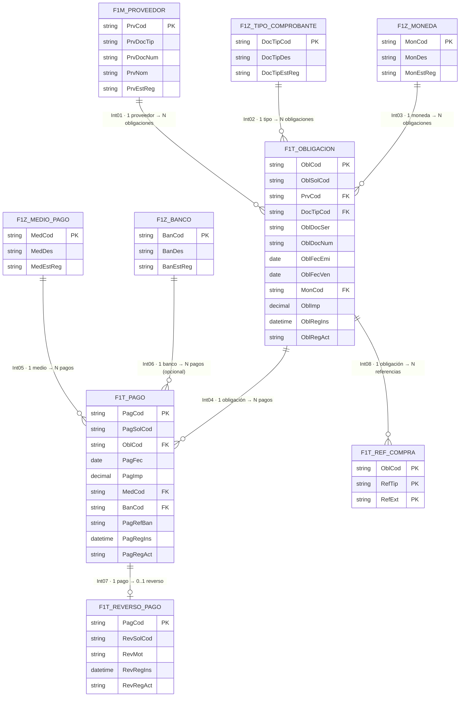

# Diccionario de datos — Cuentas por Pagar

**Módulo:** Cuentas por Pagar — Tribu de Egresos  
**Responsable:** Fernando Gerson Luque Guevara (Backend)  
**Tarea:** [T-04](https://github.com/LeonHatches/fsi-erp-cuentas-por-pagar/issues/5)

Este directorio contiene el diccionario de datos del módulo. Define las entidades, sus atributos, las interrelaciones y las reglas de negocio que debe implementar el backend en `models.py`.

---

## Archivos

| Archivo CSV | Contenido |
|---|---|
| `DICCIONARIO DE DATOS - Entidades.csv` | Catálogo de las 9 entidades del módulo con nemotécnico, nombre y descripción. |
| `DICCIONARIO DE DATOS - Tablas Referenciales.csv` | Atributos de las 4 tablas de catálogo (Z): tipo comprobante, moneda, medio de pago y banco. |
| `DICCIONARIO DE DATOS - Tablas de Datos.csv` | Atributos de las 5 tablas transaccionales (M/T): proveedor, obligación, pago, reverso de pago y referencia a compras. |
| `DICCIONARIO DE DATOS - Interrelaciones.csv` | Las 8 relaciones entre entidades con cardinalidad y clave foránea. |
| `DICCIONARIO DE DATOS - Reglas.csv` | Reglas de negocio a nivel de dato y de entidad; guían las restricciones en modelos y serializers. |

---

## Entidades

El módulo tiene **9 entidades** organizadas en tres grupos según su naturaleza:

| Prefijo | Tipo | Entidades |
|---|---|---|
| `F1Z_` | Tablas referenciales (catálogo) | `TIPO_COMPROBANTE`, `MONEDA`, `MEDIO_PAGO`, `BANCO` |
| `F1M_` | Tabla maestra | `PROVEEDOR` |
| `F1T_` | Tablas transaccionales | `OBLIGACION`, `PAGO`, `REVERSO_PAGO`, `REF_COMPRA` |

---

## Tablas referenciales (catálogos)

Contienen valores estables que clasifican las operaciones. Todas usan `EstReg` (`A`=activo / `I`=inactivo / `*`=reservado) para habilitar o deshabilitar entradas.

### F1Z_TIPO_COMPROBANTE — Tipo de comprobante

| Nemotécnico | Nombre | Tipo | Long | Condiciones |
|---|---|---|---|---|
| `DocTipCod` | Código tipo comprobante | A | 32 | PK; único y obligatorio |
| `DocTipDes` | Descripción tipo | A | 200 | Obligatoria; no única |
| `DocTipEstReg` | Estado de registro | A | 1 | `A / I / *`; solo tipos activos admiten nuevas obligaciones |

> [!NOTE]
> Permite indicar si el tipo de comprobante requiere serie (ej. facturas vs. recibos). Regla: **RE_TipDocAct** — solo tipos habilitados admiten nuevas obligaciones; exigir serie según el tipo.

---

### F1Z_MONEDA — Moneda

| Nemotécnico | Nombre | Tipo | Long | Valores | Condiciones |
|---|---|---|---|---|---|
| `MonCod` | Código moneda | A | 3 | `PEN` | PK; código alfabético de 3 caracteres |
| `MonDes` | Descripción moneda | A | 200 | — | No vacío; no único |
| `MonEstReg` | Estado de registro | A | 1 | `A / I / *` | Moneda activa para nuevas obligaciones |

> [!NOTE]
> Operación inicial en PEN. Regla: **RE_MonCoin** — pago y obligación deben usar la misma moneda.

---

### F1Z_MEDIO_PAGO — Medio de pago

| Nemotécnico | Nombre | Tipo | Long | Valores | Condiciones |
|---|---|---|---|---|---|
| `MedCod` | Código medio | A | 32 | `EFECTIVO / TRANSFERENCIA` | PK; único y obligatorio |
| `MedDes` | Descripción medio | A | 200 | — | Obligatoria |
| `MedEstReg` | Estado de registro | A | 1 | `A / I / *` | Medio habilitado para nuevos pagos |

> [!IMPORTANT]
> Regla: **RE_MedAct** — las transferencias exigen banco y referencia bancaria; el efectivo no lleva ninguno de los dos.

---

### F1Z_BANCO — Banco

| Nemotécnico | Nombre | Tipo | Long | Condiciones |
|---|---|---|---|---|
| `BanCod` | Código banco | A | 32 | PK; único y obligatorio |
| `BanDes` | Descripción banco | A | 200 | Obligatoria |
| `BanEstReg` | Estado de registro | A | 1 | `A / I / *`; banco habilitado para transferencias |

> [!NOTE]
> Catálogo de referencia. No administra cuentas ni movimientos bancarios. Regla: **RE_BanUso** — banco vacío en efectivo, requerido en transferencia.

---

## Tabla maestra

### F1M_PROVEEDOR — Proveedor

| Nemotécnico | Nombre | Tipo | Long | Condiciones |
|---|---|---|---|---|
| `PrvCod` | Código de proveedor | A | 64 | PK; único, obligatorio e inmutable |
| `PrvDocTip` | Tipo de identidad | A | 32 | Obligatorio; clave alternativa conjunta con `PrvDocNum` |
| `PrvDocNum` | Número de identidad | A | 64 | Obligatorio; conserva ceros iniciales; clave alternativa conjunta con `PrvDocTip` |
| `PrvNom` | Nombre de proveedor | A | 200 | No vacío; no único |
| `PrvEstReg` | Estado del registro | A | 1 | `A / I / *` |

> [!NOTE]
> Registro local del proveedor. La integración con Compras usará identificadores acordados. Regla: **RE_PrvIdUni** — la pareja `(PrvDocTip, PrvDocNum)` debe ser única. Regla: **RE_PrvEst** — un proveedor inactivo no invalida sus obligaciones anteriores.

---

## Tablas transaccionales

### F1T_OBLIGACION — Obligación

Deuda reconocida, sustentada por un comprobante único, con importe exacto y fecha de vencimiento.

| Nemotécnico | Nombre | Tipo | Long/Dec | Key | Condiciones |
|---|---|---|---|---|---|
| `OblCod` | Código obligación | A | 64 | PK | No nulo; inmutable |
| `OblSolCod` | Token de alta | A | 64 | — | Idempotencia; no sustituye identidad documental |
| `PrvCod` | Proveedor | A | 64 | FK → `F1M_PROVEEDOR` | Parte de la clave documental |
| `DocTipCod` | Tipo de comprobante | A | 32 | FK → `F1Z_TIPO_COMPROBANTE` | Parte de la clave documental |
| `OblDocSer` | Serie comprobante | A | 64 | — | Serie canónica; vacía solo si el tipo lo permite |
| `OblDocNum` | Número comprobante | A | 64 | — | No vacío; conserva ceros y guiones |
| `OblFecEmi` | Fecha de emisión | DATE | — | — | `AAAA-MM-DD`; válida y real |
| `OblFecVen` | Fecha vencimiento | DATE | — | — | Igual o posterior a la fecha de emisión |
| `MonCod` | Moneda | A | 3 | FK → `F1Z_MONEDA` | Sin conversión de moneda |
| `OblImp` | Importe obligación | N | 14,2 | — | `> 0`; `NUMERIC(14,2)`; rango `0.01 – 999 999 999 999.99` |
| `OblRegIns` | Instante de registro | TIMESTAMPTZ | — | — | Generado por el servidor |
| `OblRegAct` | Actor del registro | A | 128 | — | Usuario o servicio que registró la obligación |

> [!IMPORTANT]
> **Clave documental única (UNIQUE):** `(PrvCod, DocTipCod, OblDocSer, OblDocNum)` — un comprobante genera exactamente una obligación.  
> Reglas clave: **RE_OblKDoc**, **RE_OblImpPos**, **RE_OblInmut**, **RE_OblEstDer** (saldo calculado desde pagos efectivos, sin columna de saldo duplicada).

---

### F1T_PAGO — Pago

Pago registrado y aplicado íntegramente a una sola obligación. Admite pagos parciales.

| Nemotécnico | Nombre | Tipo | Long/Dec | Key | Condiciones |
|---|---|---|---|---|---|
| `PagCod` | Código pago | A | 64 | PK | Único e inmutable |
| `PagSolCod` | Token de pago | A | 64 | — | Idempotencia de solicitud |
| `OblCod` | Obligación destino | A | 64 | FK → `F1T_OBLIGACION` | Un destino por pago |
| `PagFec` | Fecha de pago | DATE | — | — | Válida; igual o posterior a emisión del comprobante |
| `PagImp` | Importe pago | N | 14,2 | — | `> 0`; no superior al saldo disponible; `NUMERIC(14,2)` |
| `MedCod` | Medio de pago | A | 32 | FK → `F1Z_MEDIO_PAGO` | Obligatorio |
| `BanCod` | Banco referencial | A | 32 | FK → `F1Z_BANCO` (opcional) | Vacío en efectivo; requerido en transferencia |
| `PagRefBan` | Referencia bancaria | A | 128 | — | Requerida en transferencias; vacía en efectivo |
| `PagRegIns` | Instante registro pago | TIMESTAMPTZ | — | — | Generado por el servidor |
| `PagRegAct` | Actor del pago | A | 128 | — | Usuario autorizado que registró el pago |

> [!IMPORTANT]
> Reglas clave: **RE_PagSaldo** (suma de pagos efectivos ≤ importe de la obligación), **RE_PagAtom** (pago y efecto económico confirmados atómicamente), **RE_PagMed** (efectivo sin banco ni referencia; transferencia exige ambos).

---

### F1T_REVERSO_PAGO — Reverso de pago

Reversión íntegra de un pago. Máximo un reverso por pago. No se puede revertir un reverso.

| Nemotécnico | Nombre | Tipo | Long | Key | Condiciones |
|---|---|---|---|---|---|
| `PagCod` | Pago revertido | A | 64 | PK + FK → `F1T_PAGO` | Un único reverso por pago |
| `RevSolCod` | Token de reverso | A | 64 | — | Idempotencia; no duplica el reverso |
| `RevMot` | Motivo reversión | A | 500 | — | Obligatorio; no vacío |
| `RevRegIns` | Instante reversión | TIMESTAMPTZ | — | — | Generado por el servidor |
| `RevRegAct` | Actor reversión | A | 128 | — | Usuario autorizado para revertir |

> [!NOTE]
> Reglas clave: **RE_RevUnico** (máximo un reverso íntegro por pago), **RE_RevEfect** (el pago revertido se excluye del cálculo del saldo), **RE_RevPerm** (solo usuarios autorizados revierten).

---

### F1T_REF_COMPRA — Referencia a Compras

Identificadores de recursos externos del módulo de Compras vinculados a una obligación. No almacena cantidades.

| Nemotécnico | Nombre | Tipo | Long | Key | Valores | Condiciones |
|---|---|---|---|---|---|---|
| `OblCod` | Obligación vinculada | A | 64 | PK + FK → `F1T_OBLIGACION` | — | Componente de PK |
| `RefTip` | Tipo de recurso | A | 32 | PK | `OC / OC_LINEA / RECEPCION / RECEPCION_LINEA / CONFORMIDAD` | Componente de PK |
| `RefExt` | Identificador externo | A | 128 | PK | — | Identificador estable del recurso en Compras; sin FK física |

> [!NOTE]
> Su validación requiere contrato con Compras. La conciliación por cantidades requiere detalle adicional fuera del alcance del primer incremento.

---

## Interrelaciones

---

## Reglas de negocio destacadas

Las reglas completas están en `DICCIONARIO DE DATOS - Reglas.csv`. Se resumen las más críticas para la implementación:

| Código | Ámbito | Regla |
|---|---|---|
| `RE_OblKDoc` | Obligación | Clave documental única: `(PrvCod, DocTipCod, OblDocSer, OblDocNum)` → `UniqueConstraint` en Django |
| `RE_OblImpPos` | Obligación | Importe `> 0`; `NUMERIC(14,2)`; no usar `FLOAT` → `CheckConstraint` en Django |
| `RE_OblVenVal` | Obligación | Vencimiento `≥` emisión → `CheckConstraint` en Django |
| `RE_OblInmut` | Obligación | Datos económicos aceptados son inmutables → validación en serializer |
| `RE_OblEstDer` | Obligación | Saldo calculado desde pagos efectivos; no almacenar saldo como columna |
| `RE_PagSaldo` | Pago | Suma de pagos efectivos `≤` importe de la obligación; `saldo ≥ 0` |
| `RE_PagAtom` | Pago | Pago y efecto económico confirmados en `transaction.atomic()` |
| `RE_PagMed` | Pago | Efectivo: `BanCod` y `PagRefBan` vacíos; transferencia: ambos obligatorios |
| `RE_RevUnico` | Reverso | Máximo un reverso íntegro por pago; no se revierte un reverso |
| `RE_RevEfect` | Reverso | Pago revertido excluido del cálculo del saldo |
| `RE_PrvIdUni` | Proveedor | La pareja `(PrvDocTip, PrvDocNum)` debe ser única → `UniqueConstraint` |
| `RE_TipDocAct` | Tipo comprobante | Solo tipos con `DocTipEstReg = A` admiten nuevas obligaciones |
| `RE_OblAltaAtom` | Obligación | Obligación y referencias a Compras se registran en una única transacción |

---

## Alcance del primer incremento

> [!IMPORTANT]
> El primer CRUD implementa únicamente **F1T_OBLIGACION** (registrar, consultar, modificar, anular) y sus dependencias directas de catálogo (`F1Z_*` y `F1M_PROVEEDOR`). **F1T_PAGO**, **F1T_REVERSO_PAGO** y **F1T_REF_COMPRA** se modelan para no romper el esquema futuro, pero sus servicios CRUD se implementan en un incremento posterior.

---

## Convenciones de tipos en Django

| Tipo lógico | Tipo físico (PostgreSQL) | Campo Django |
|---|---|---|
| Texto (A) | `VARCHAR(n)` | `models.CharField(max_length=n)` |
| Numérico exacto (N 14,2) | `NUMERIC(14, 2)` | `models.DecimalField(max_digits=14, decimal_places=2)` |
| Fecha | `DATE` | `models.DateField()` |
| Instante con zona | `TIMESTAMPTZ` | `models.DateTimeField()` |
| FK local | `VARCHAR(n)` + FK | `models.ForeignKey(..., on_delete=models.PROTECT)` |

> [!TIP]
> Los montos (`OblImp`, `PagImp`) se envían como texto en la API (DRF serializa `DecimalField` como string) para conservar la precisión exacta. El frontend los declara como `string` en TypeScript y no los opera como `number`.
